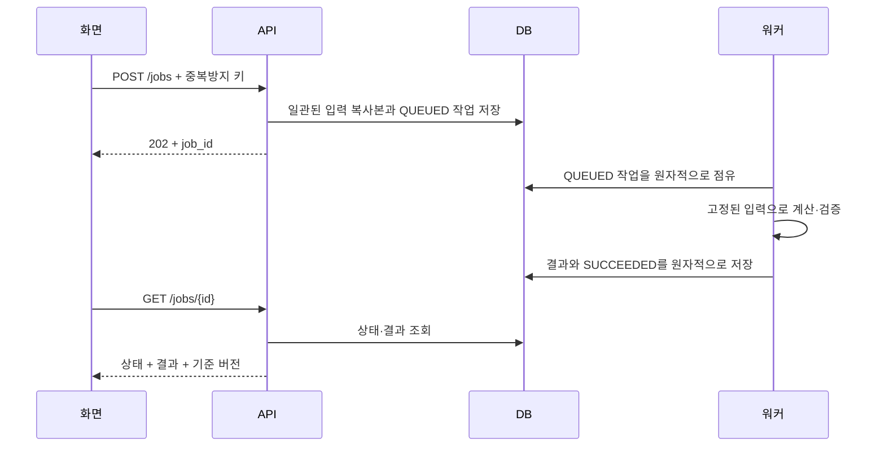

# 주제가 바뀌어도 유지되는 구현 전략

이 문서는 권장 설계다. 현재 폴더에 이 서버·DB·작업 큐가 구현돼 있다는 뜻은 아니다. 시험에서 제공된 스택과 기존 구조가 있으면 먼저 유지한다.

## 1. 첫 10분: 문제를 코드 구조보다 먼저 좁힌다

다음 여섯 문장을 실제 자료로 채운다.

1. 사용자는 누구이고, 결과로 어떤 결정을 하는가?
2. 입력 한 행/한 요청은 무엇을 뜻하며, 식별자는 무엇인가?
3. 결과는 지도·표·추천·판정·일정·보고서 중 무엇인가?
4. 반드시 지켜야 할 제약과 좋아질수록 좋은 지표는 무엇인가?
5. 데이터가 얼마나 크며, 계산 시간과 변경 빈도는 어느 정도인가?
6. 완료를 어떤 입력과 기대 결과로 확인할 것인가?

버스에서는 차량 정원, 작업 배정에서는 설비 처리량, 재고에서는 가용 재고가 자원 제약이다. 같은 구조가 재사용되지만 제약의 의미는 별도 확인한다. **오늘 최적화 문제가 나온다고 전제하지 않는다.**

## 2. 문제 유형에 따라 알고리즘을 고른다

| 문제의 실제 구조 | 먼저 검토할 방법 | 선택 전에 확인할 것 |
|---|---|---|
| 필터·집계·기준값 판정 | SQL/데이터프레임/명시적 규칙 함수 | 행의 의미, 중복, 분모, 날짜 범위 |
| 단일 경로 탐색 | BFS, Dijkstra 등 | 가중치 유무·음수·방향·시간 의존성 |
| 일대일/용량 있는 배정 | 매칭, 최소비용흐름 | 분할 가능 여부, 비용 구조, 정수 제약 |
| 시간·순서·자원 간 결합 제약 | CP-SAT, MILP | 규모, 시간 한도, 모델링·설치 가능성 |
| 큰 조합 문제, 빠른 근사 필요 | 탐욕 초기해 + 국소 개선 | 유효해 보장, 기준선, 종료 조건 |
| 사건 발생 순서에 따라 상태 변경 | 이산사건 시뮬레이션 | 사건 순서·동시 사건·시간 단위 |
| 과거 데이터로 미래 예측 | 단순 기준선 → 통계/ML | 시간 분할, 누수, 지표, 불확실성 |
| 비정형 문서 검색·요약 | 규칙 검색 또는 필요 시 RAG | 원문 근거, 누락, 답변 불가 처리 |

규칙 판정에 최적화 솔버를 넣거나, 단순 집계에 LLM을 넣지 않는다. 수학적으로 풀 수 있는 배정 문제를 무조건 휴리스틱으로 바꾸지 않는다.

OR-Tools CP-SAT는 결과를 OPTIMAL, FEASIBLE, INFEASIBLE, UNKNOWN 등으로 구분한다. 시간 한도 내 실행 가능해를 찾은 것과 최적성을 증명한 것은 다르다. UNKNOWN을 “해 없음”으로 표시하면 틀릴 수 있다. [공식 솔버 설명](https://developers.google.com/optimization/cp/cp_solver)

## 3. 휴리스틱을 골랐다면 최소한 이 여섯 가지를 남긴다

- 실제 목적함수: 무엇을 얼마나 줄이거나 늘리는가?
- 하드 제약: 결과를 내기 전에 반드시 검사할 조건.
- 초기해: 예를 들어 마감 임박 순서의 탐욕 배정.
- 개선 연산: 재배치/교환/삽입 중 실제 구현한 것.
- 종료 조건: 반복 횟수·시간·개선 정체 중 실제 기준.
- 품질 근거: 같은 입력의 기준선과 작은 정답 사례.

**학습용 예:** 마감 임박 순서로 작업을 배정하고, 동일 설비에 놓인 두 작업 순서를 바꿔 총 지연을 줄인다. 이동이 생길 때마다 중복 배정·처리 가능 설비·시간 겹침을 검증한다. 단순히 점수가 낮아졌다고 유효한 결과가 되지는 않는다.

최소화 지표의 기준선 대비 개선율은 `(기준선 - 결과) / 기준선`이다. 기준선이 0이면 이 비율을 쓰지 않는다. 최적값과 비교하지 않은 개선율을 “최적 대비 오차”라고 부르지 않는다. 표본 수·데이터 버전·반복 실행·실행 환경을 함께 적고 측정하지 않은 수치는 비워 둔다.

## 4. 최소 구조: 한 요청의 끝까지 먼저 만든다

```text
화면/CLI
  → 입력 검증
  → 업무 서비스
  → 계산/판정 함수
  → 결과 저장(요구될 때)
  → 응답/조회/내보내기
```

파일 경계는 이 역할이 보일 정도면 충분하다. API 하나인데 범용 추상 계층을 여러 개 만들 필요는 없다. 계산 함수가 UI나 DB 연결에 직접 의존하지 않게 하면 손으로 정답을 아는 입력으로 테스트하기 쉽다.

권장 폴더 예시:

```text
api/          요청·응답·인증·HTTP 오류 변환
domain/       업무 규칙·상태·계산, 외부 I/O와 분리
services/     입력 조회→계산→저장의 흐름
storage/      DB/파일 읽기·쓰기
tests/        실제 수락 조건과 실패 사례
docs/         선택·검증·한계 기록
```

단순 파일 분석 과제라면 `main.py`, `rules.py`, `tests/`만으로도 충분하다. 이미 제공된 구조를 이 예시로 갈아엎지 않는다.

## 5. 긴 계산일 때만 작업 모델을 더한다



외부 큐를 따로 쓰면 DB 저장과 큐 발행 사이 실패가 생길 수 있다. 작은 구현은 **DB의 작업 테이블 자체를 큐로 사용**해 이 경계를 줄일 수 있다. 외부 큐를 쓰는 경우에는 트랜잭셔널 아웃박스 또는 미발행 작업을 재전송하는 복구가 필요하다.

추천 작업 필드:

```text
id, owner_id, idempotency_key, request_hash,
input_snapshot, input_version, config_version,
algorithm_version, seed,
status, attempt, attempt_token, lease_expires_at,
created_at, started_at, finished_at,
result, error_code, retryable
```

작업 키에는 사용자/프로젝트 범위를 둔다. 같은 키에 다른 내용이 오면 충돌을 반환한다. seed·코드 버전 기록은 재현에 도움이 되지만 병렬 솔버·외부 호출까지 완전 결정론을 보장하지는 않는다.

상태 전이 예:

```text
QUEUED → RUNNING → SUCCEEDED / FAILED / CANCELLED
RUNNING → CANCEL_REQUESTED → CANCELLED
```

실제 취소는 계산 루프가 안전한 지점에서 중단 신호를 확인해야 한다. 상태 글자만 바꾸고 계속 결과를 저장하면 취소 구현이 아니다. 강제 종료는 예외 처리기가 실행되지 않을 수 있으므로 lease/heartbeat 만료도 고려한다. 재시도 전 작업을 다시 점유하며, 이전 시도의 늦은 결과는 `attempt_token`을 비교해 거절한다.

## 6. 계산 중 기준 데이터가 바뀌는 문제

예: t0에 용량 40으로 시작 → t1에 관리자가 30으로 변경 → t2에 38을 배정한 계산 완료.

- **이력 보존:** 40 기준의 결과임을 명시하고 저장할 수 있다.
- **현재 적용:** 30 기준 제약을 만족하는지 재검증하기 전 자동 적용하면 안 된다.
- **재계산:** 입력 복사본을 유지한 재시도와, 최신 입력으로 만든 새 작업을 구분한다.
- **재현:** 과거 데이터가 보존되지 않는다면 `version=7`이라는 숫자만으로 과거 입력을 복구할 수 없다.

설정/데이터를 복사할 때도 일관된 시점이 필요하다. 짧은 Repeatable Read 트랜잭션, 불변 버전 테이블, 일관된 단일 읽기 중 환경에 맞는 방식을 고른다. PostgreSQL 기본 Read Committed에서는 같은 트랜잭션 안의 두 SELECT도 서로 다른 커밋을 볼 수 있다. [공식 격리 수준 문서](https://www.postgresql.org/docs/current/transaction-iso.html)

최종 적용에서는 관련 버전 행을 잠그거나 조건부 갱신하여 **버전 확인과 적용을 같은 원자적 절차**로 처리한다. 버전을 확인한 다음 별도 저장하면 그 사이 또 변경될 수 있다. 모든 관련 변경이 버전을 올리도록 쓰기 경로도 통제해야 한다. 계산 전체 시간 동안 DB 잠금을 잡는 방식은 피한다.

## 7. 제한 시간 안의 구현 순서

아래는 공식 시간표가 아닌 남은 시간 비율의 제안이다.

| 구간 | 할 일 | 남길 증거 |
|---|---|---|
| 첫 15% | 요구·파일·실행 방법·대표 데이터 파악 | 사실/가정/수락 조건 |
| 다음 45% | 작은 입력의 입력→처리→결과를 끝까지 구현 | 실제 실행 결과 |
| 다음 20% | 실패·경계·설정 변경 중 핵심 위험 보완 | 재현과 테스트 |
| 다음 10% | 제출 방식/미리보기/배포 확인 | 주소·명령·저장/재조회 |
| 마지막 10% | 실제 코드의 모듈·흐름·한계 설명 연습 | 설명 기록 양식 |

초반에 실행 환경과 제출 경로부터 확인하고 배포 위험이 크면 더 일찍 작은 배포를 확인한다. 로그인·대시보드·큐·Docker를 모든 문제의 기본 범위로 넣지 않는다.
